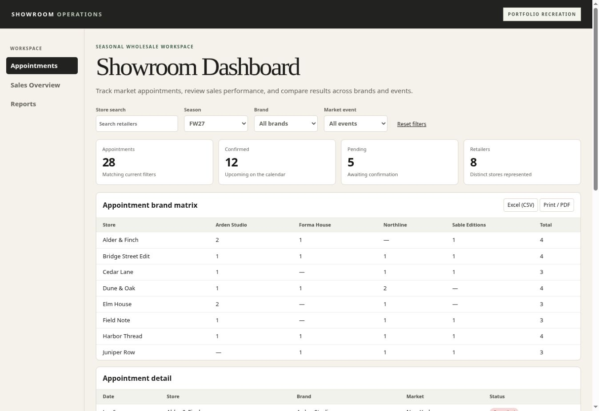
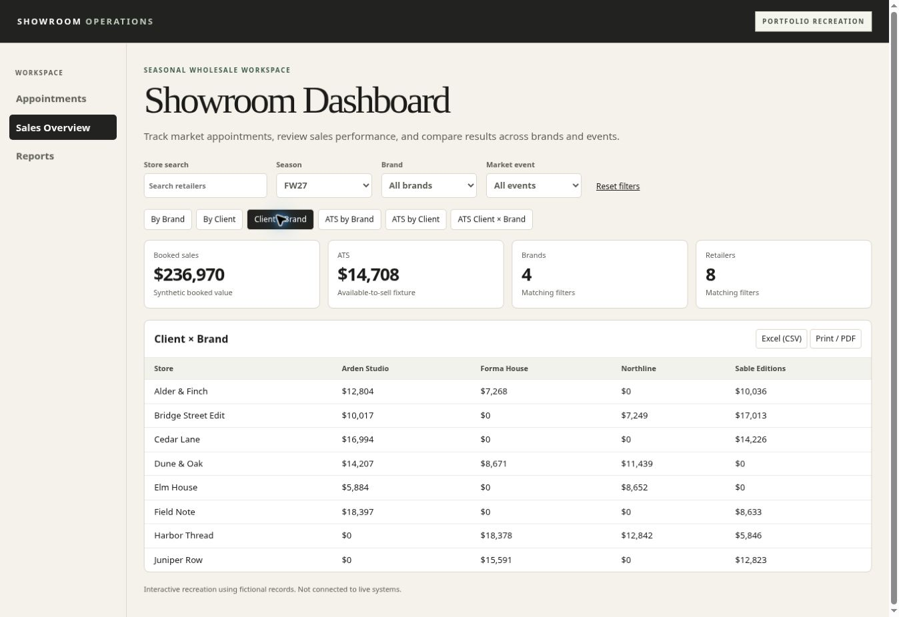
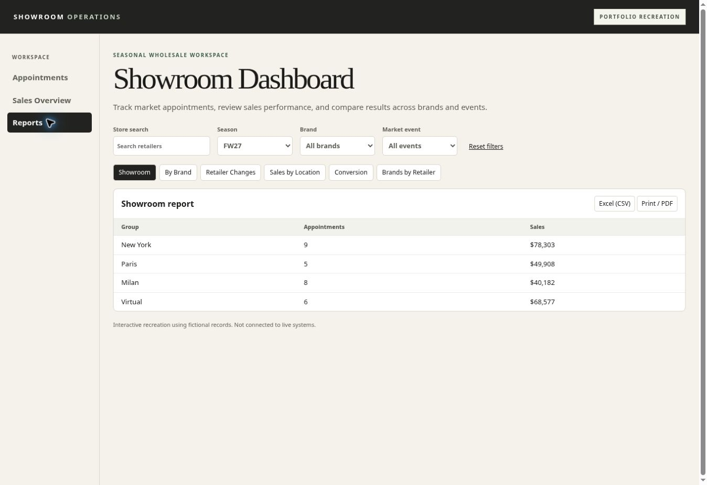

# Showroom Dashboard

The code is based on tools I developed for real showroom workflows. The records and figures shown are fictional to protect client confidentiality.

This repository contains an interactive portfolio recreation, not the original production application. The interface reflects the original workflow, but all sample records and amounts are fictional. Production data, credentials, client identities, and private links are not included.

**Problem:** The team needed to see who was booked for each market, what brands retailers were coming to see, and how sales compared across brands and markets.

**What I built:** A web dashboard that combines market appointments, sales analysis, and seasonal reporting. In the original system, I used Google Apps Script to bring calendar and CRM data into Google Sheets and built the web interface in HTML, CSS, and JavaScript.

| View | What it shows |
| --- | --- |
| Appointments | Filters for retailer, season, brand, and market; a retailer-by-brand matrix; and appointment detail. |
| Sales Analysis | Sales by brand or retailer, a retailer-by-brand comparison, and separate available-to-sell (ATS) views. |
| Reports | Showroom summaries, brand and market breakdowns, retailer changes between seasons, and conversion views. |

[Open the dashboard](index.html). Try searching for a retailer, then switch to Sales Overview and choose Client × Brand. In Reports, compare Sales by Location with Conversion.

## Run locally

Open `index.html` in a modern browser. No installation, sign-in, network connection, or backend is required. Changes reset when you reload. Use fictional information only.
